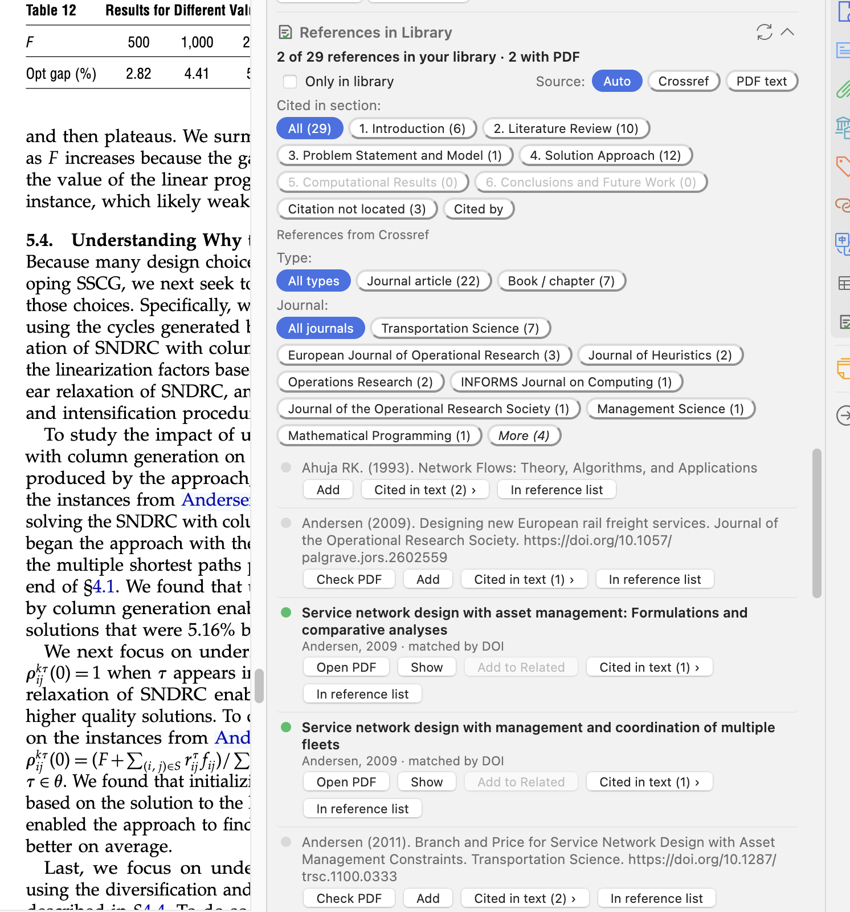

# Reference Checker for Zotero

See which references of an article you already have in Zotero, open their PDF in one click, jump to where they're cited, and add the missing ones to a collection with their PDF.

Works with Zotero 7 to 11 (built and checked on Zotero 10.0.6), on Windows, macOS and Linux.



## Install

1. Download `zotero-reference-checker.xpi` from the [latest release](https://github.com/najibprog/zotero-reference-checker/releases/latest).
2. In Zotero, go to **Tools → Plugins**, click the ⚙︎ menu, choose **Install Plugin From File…**, and pick the `.xpi`.

Zotero then checks for updates and installs them automatically.

## Use

### In the PDF reader

Open an article. In the right-hand pane, open the **References in Library** section (its icon is a page with a green check).

**The list:**

- The header shows the counts, for example *12 of 48 references in your library · 9 with PDF · 3 related*.
- In articles with numbered citations, each row starts with its number, for example **[12]**.
- 🟢 **Green**: in your library, with a PDF. Click the row or **Open PDF** to open it in a new tab.
- 🟠 **Orange**: in your library, no file.
  - **Find PDF** downloads it if it can: through the Elsevier API (if configured), the publisher's page, or open-access copies.
  - **Open in browser** lets you save the PDF with the Zotero Connector.
  - **Show** selects the item in your library.
- 🟢 and 🟠 rows show **↔ Related** when the item is a Related item of the open article. **Add to Related** and **Remove from Related** link or unlink them both ways, like Zotero's Related box.
- ⚪ **Grey**: not in your library.
  - **Check PDF** looks for the PDF. If it finds one, it asks which collection to save it in, then saves the reference and the PDF.
  - **Add** opens the article in your web browser (its DOI page, or a Google Scholar search) so you can save it with the **Zotero Connector**. This uses your browser's access (VPN, campus login…), and the panel turns green by itself once the item arrives.

**Filters:**

- **Only in library** hides the grey entries.
- **Order**: *Reference list* keeps the order of the article's bibliography; *Order in text* lists references in the order they are first cited. With a section selected, it follows the order within that section. References whose citation wasn't located come last.
- **Type** shows only one kind of publication: *Journal article*, *Conference paper*, *Book / chapter*, *Thesis*, *Report*, *Preprint* or *Other*, with a count for each. It comes from the library item when the reference is in your library, from Crossref or OpenAlex when they say, and otherwise is guessed from the reference text.
- **Journal** shows only the references published in one journal. The most frequent journals are listed first; **More** shows the rest. Journal names are known for references in your library and those from Crossref or OpenAlex, not for references read from the PDF text.
- **Cited in section** shows only the references cited in one part of the article, such as *1. Introduction* or *2. Literature review*. Each section shows a count. *Citation not located* lists the rest.
- **Source** sets where the reference list comes from:
  - **Auto** (default): Crossref when the article has a DOI and Crossref has its references; otherwise the PDF text.
  - **Crossref**: always Crossref.
  - **PDF text**: always the References section of the PDF.

**Navigation:**

- **Cited in text (3) ›** shows how many times the reference is cited: in the selected section, or in the whole article under **All**. Clicking jumps to a citation and briefly highlights it; click again for the next one. The button then shows *1/3*, *2/3*… With a section selected, only that section's citations are visited.
- **In reference list** jumps to the reference's entry in the article's bibliography.
- The ↻ button in the section header scans again.

**Going back to the article:** after **Open PDF**, **Show**, or a click on a 🟢 or 🟠 row, you land in the cited article's PDF or in your library. There:

- The **References in Library** section works as usual, for that article.
- A temporary red **←** icon appears in the right-hand side bar, just below the References in Library icon. Click it to return to the article you came from.
- The section also starts with a **← Back to “article”** button that does the same.
- Back on the article, the list scrolls to the reference you used and highlights it briefly. This also happens if you switch back to the article's tab yourself.
- The red icon goes away once you're back, or if you close the article's tab.

**Select text in the PDF:** highlight a reference in the bibliography. The popup shows *In library: …* with an **Open PDF** button, or *Not in your library* with an **Add** button.

**Selected text:** select a sentence or paragraph in the PDF, and the panel shows only the references cited in it ("(Smith et al., 2019; Jones, 2018)", "[3, 5–7]"). Selecting just the names, such as "Smith and Jones", also works; if that author has several references, they are all shown, under a **Selected text (N)** chip. Selecting an entry of the reference list shows just that reference. Click **All** or another chip to go back.

**Cited by:** the last chip of the section filter, **Cited by**, swaps the list for the articles that cite this one, from [OpenAlex](https://openalex.org). It needs the article's DOI.

- The chip shows the count once loaded, and the list header shows for example *135 articles cite this one · 12 in your library · 9 with PDF*.
- Rows use the same colours and buttons as references: 🟢 **Open PDF**, 🟠 **Find PDF** / **Open in browser**, ⚪ **Check PDF** / **Add** (opens the DOI page so you can save it with the Zotero Connector). Each row also shows how often that article is cited.
- **Sort**: *Most cited*, *Newest* or *Oldest*. **Only in library**, **Type** and **Journal** work here too.
- 100 articles load at a time; **Load more** gets the next ones.

### In the library view

Select an item and click **Check references against my library**. The plugin doesn't scan in this view automatically, so browsing stays fast.

## Settings

Go to **Zotero → Settings → Reference Checker** (on Windows and Linux: **Edit → Settings**).

### Elsevier / ScienceDirect (optional)

ScienceDirect blocks automated downloads, so Zotero's normal PDF search usually fails there. Elsevier offers an official API instead:

1. Create your own free key at https://dev.elsevier.com/apikey/manage. Keys are personal; don't share yours.
2. Paste it in **API key** and click **Test key**.
3. **Institutional token**: full-text access through the API usually also needs a token, which only your institution can request from Elsevier. Ask your library for one.

**Check PDF** and **Find PDF** then try the Elsevier API first for Elsevier DOIs (`10.1016/…`). If access is refused, the reason appears under the reference.

### Crossref (optional)

A contact email that is sent to Crossref with each request, as Crossref asks. Requests that include one are served faster.

### OpenAlex (optional)

Without a key, everyone on your network shares one small free daily allowance for **Cited by**. If you see a "daily limit" message, create a free key at https://openalex.org/settings/api and paste it in **API key**.

## How it works

**Matching a reference to your library:**

1. **DOI**: a DOI in the reference matches the DOI field of a library item, or a DOI in its *Extra* or *URL* field.
2. **Title**: the library item's title appears in the reference text. Case, accents, punctuation and line breaks are ignored. Titles shorter than 25 characters only count if the first author's surname appears too.

**Reading the reference list from the PDF:** the plugin finds the last *References* / *Bibliography* / *Références* heading and splits the text into entries. It handles numbered (`[1]`, `1.`), APA/Harvard and Springer/Vancouver styles. If the entries can't be separated, it lists only the library items found in the reference section.

**Sections and citations:**

- **Sections** come from numbered headings that follow each other in order (`1. Introduction`, `2 Literature review`, `III. METHOD`), or else from common heading names in English, French, Spanish and German.
- **Citations** are found as:
  - numbered: `[12]`, `[3–5]`, `[1, 4]`, or in parentheses `(12)`, or as superscripts (read from the PDF as `routing12,13`). The style that locates the most references wins; parentheses and superscripts need at least 3 references and 30% of the list, so numbered equations don't count;
  - author–year: `(Smith et al., 2019)`, `Smith et al. (2019)`, `Smith et al. 2019`, `Smith and Jones (2018)`, `Smith et al. (2019a, 2020)`, `Smith (2019, p. 4)`.
- Accents are ignored, including the detached accents PDFs often produce (`Mladenovi ́c`).
- If nothing with a year is found, **Cited in text** falls back to `Smith et al.` or `Smith and Jones`.
- Crossref often lists references by their DOI only. The plugin then fetches their first author, year and title from Crossref, so their citations can be found and the list shows the work instead of a bare DOI.
- **In reference list** looks for the reference's title or DOI first, then its number or author and year.

## Privacy

The plugin only contacts these services:

| Service | When | What is sent |
|---|---|---|
| `api.crossref.org` | Source **Auto** or **Crossref** | The open article's DOI, and the DOIs of its references when Crossref lists them without details (plus your contact email, if you set one) |
| `api.openalex.org` | **Cited by** | The open article's DOI (and your OpenAlex API key, if you set one) |
| `doi.org` and the publisher's site | **Check PDF**, **Find PDF** | The DOI of the reference |
| Zotero's open-access lookup (`services.zotero.org`) | **Check PDF**, **Find PDF** | The DOI of the reference |
| `api.elsevier.com` | **Check PDF**, **Find PDF**, only for Elsevier DOIs when an API key is set | The DOI, your API key and token |
| Your web browser | **Add**, **Open in browser** | Opens the DOI page or a Google Scholar search |

With **Source = PDF text** and without clicking those buttons, everything stays on your computer. Your library is never sent anywhere.

## Development

```
manifest.json            plugin metadata (ID, version, update URL)
bootstrap.js             startup/shutdown hooks
prefs.js                 default preferences
content/refcheck.js      all logic: library index, parsing, matching, UI
content/refcheck.css     panel styles
content/icons/           section and "back" icons
content/preferences.xhtml  Settings page
locale/en-US/            section titles and tooltips
test/                    unit tests (node --test)
scripts/                 release helpers
.github/workflows/       CI (tests + build) and release
```

- Run the tests: `npm test` (Node 22 or later; no dependencies).
- Build the `.xpi`: `sh build.sh`.

If something goes wrong at startup, the plugin writes `reference-checker-startup.log` to the Zotero data folder. Navigation errors go to `reference-checker-errors.log` in the same folder.

## Releasing

1. Run through the manual checklist below.
2. Tag and push. The version comes from the tag:
   ```bash
   git tag v1.3.3
   git push origin v1.3.3
   ```
3. The **Release** workflow runs the tests, sets the version in `manifest.json`, builds `zotero-reference-checker.xpi`, publishes the GitHub release, and updates `updates.json` in the fixed `release` release. That's the file Zotero checks for updates, so don't delete that release.

### Manual test checklist

The parts that depend on Zotero's interface, your browser or your network can't be tested in CI. Before each release, check in Zotero:

- [ ] The plugin installs and restarts cleanly. No `reference-checker-startup.log` appears in the Zotero data folder.
- [ ] **Settings → Reference Checker** opens. **Test key** answers.
- [ ] Opening an article shows the **References in Library** section with counts.
- [ ] 🟢 rows open the PDF. **Show** selects the item.
- [ ] After **Open PDF** and **Show**, the red **←** side-bar icon appears and returns to the article, which scrolls to the reference used.
- [ ] **Cited by** loads citing articles; **Sort** and **Load more** work.
- [ ] **Type**, **Journal** and **Selected text** filter the list. **Add to Related** / **Remove from Related** update the article's Related box.
- [ ] **Only in library**, **Cited in section**, **Order** and **Source** filter, reorder or reload the list.
- [ ] **Cited in text ›** jumps and highlights, and cycles *1/n → 2/n*. **In reference list** jumps to the entry.
- [ ] **Check PDF** on an open-access reference asks for a collection and saves the item with its PDF.
- [ ] **Add** opens the browser. After saving with the Connector, the row turns green by itself.
- [ ] **Find PDF** on an orange row attaches a PDF, or shows why not.
- [ ] Selecting a reference in the PDF shows the popup.
- [ ] Library view: **Check references against my library** works.

## License

[MIT](LICENSE)
